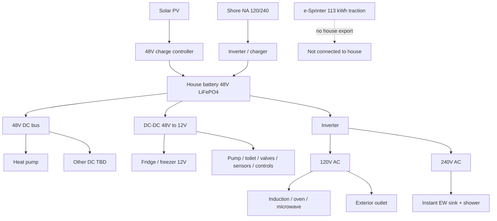

# Electrical Architecture

> Status: `researching`

**Governing ADRs:** [ADR-0002](../05-decisions/0002-mercedes-e-sprinter-platform.md) · [ADR-0003](../05-decisions/0003-all-electric-house-systems.md) · [ADR-0004](../05-decisions/0004-48v-house-dc-bus.md)

## Design goals

- Target off-grid nights: ~3 without want
- Shore power: **50A RV socket** on the van (120/240V) into the house inverter/charger. A **30A pedestal uses an adapter** into that socket. A second exterior socket is **J1772 into the house battery** (campsite or home EVSE). Traction charging stays on the Mercedes port at the front.
- Home charge (traction): Level 2 **11.5 kW** already owned; DCFC on road trips. **One EVSE, shared.** Overnight it charges the drive battery **or** the house bank, not both at once
- House storage: **separate 48V** LiFePO₄ bank (or solid-state later) — not the 113 kWh drive battery
- **48V DC** bus for heat pump + fridge/freezer (and other DC loads as designed)
- Inverter/charger: **120V + 240V** AC output — cooking mostly 120V; **instant HW is 240V**
- Solar PV: **fill the roof** except the reserved heat-pump opening. Target is a moderate-use day replaced by the roof. Shore power is the backup. **Hood solar is in scope** if it can live with hood heat and the wipers. Long-trip surplus also comes from **deployable solar on the trailer**
- Solar thermal: deployable parabolic collector on the **trailer** preheats the van warm-water tank (see [water](water.md))
- Trailer inlet: dedicated van-wall socket → **DC-DC into the 48V house bank**. Trailer batteries and MPPT stay on the trailer
- House battery kWh is sized for the **future 48V heat pump** even though the first trip does not install it ([heating-cooling](../03-features/heating-cooling/README.md))
- Controls power for tank sensors + electric dump valves (app) — see [connectivity](../03-features/connectivity/README.md)

## Voltage domains

| Domain | Used for |
|--------|----------|
| **48V DC** | Heat pump, fridge/freezer, house battery bus; other DC TBD |
| **120V AC** | Induction, oven/air-fryer, microwave, exterior outlet (and similar) |
| **240V AC** | Instant electric water heaters (sink + shower) — high power |
| Low-voltage DC (12V?) | Lights / small electronics / many pumps & valves — derive from 48V TBD |

## Block diagram

\* Solid-state house cells OK if practical at build time.

## Known major loads (direction)

| Load | Power domain | Notes |
|------|--------------|-------|
| Heat pump | **48V DC** | HVAC |
| Fridge / freezer | **12V DC** (via 48V→12V DC-DC) | Medium dual-hinge class — see [daily energy budget](daily-energy-budget.md); ADR-0004 amend pending |
| 2-burner induction | 120V AC | Indoor + movable to exterior outlet |
| Combo oven / air-fry / toast | 120V AC | e.g. Ninja Flip class |
| Small microwave | 120V AC | |
| Instant electric HW (×2) | **240V AC** | Sink + shower; solar thermal preheat reduces duty |
| Exterior AC outlet | 120V AC | Grill / outdoor induction |
| Demand pump | DC TBD | |
| Electric dump ball valves | DC + controls | Grey + black; app actuated |
| Tank level sensors | Low power DC / controls | Fresh + grey + black → app |
| UV water irradiator | TBD (often 12V or 120V) | After fine filter; serviceable lamp |
| Marine electric toilet | DC TBD | |

## Major decisions (links)

| Topic | Status | Doc / ADR |
|-------|--------|-----------|
| No combustion fuels | accepted | [ADR-0003](../05-decisions/0003-all-electric-house-systems.md) |
| Separate house battery | accepted | [ADR-0003](../05-decisions/0003-all-electric-house-systems.md) |
| **48V DC** bus + heat pump + fridge | accepted | [ADR-0004](../05-decisions/0004-48v-house-dc-bus.md) |
| Instant HW on **240V AC** | accepted | [water](water.md) |
| House kWh | open | Driven by [daily energy budget](daily-energy-budget.md). **Include the heat pump** even though first-trip install waits |
| Fridge on 12V via DC-DC (vs native 48V) | proposed | GE / Furrion 12V candidates; amend ADR-0004 |
| 12V derived bus for lights/valves/etc. | open | Same DC-DC domain as fridge likely |
| Inverter topology (split-phase 120/240) | open | Must feed 240V EW + 120V cook |
| Solar PV size | open | Driven by daily energy budget |
| Exterior AC circuit | open | GFCI / weatherproof |

## Interfaces

- Depends on: roof layout (PV + thermal stowage + fans), insulation, weight (~2,624 lb payload class)
- Provides to: galley, climate, plumbing (incl. 240V HW, valves, sensors), lights, pumps, devices
