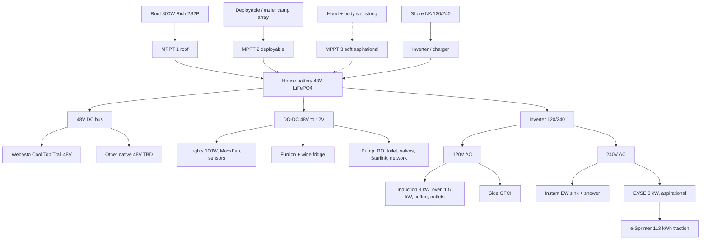

# Electrical Architecture

> Status: `researching`

**Governing ADRs:** [ADR-0002](../05-decisions/0002-mercedes-e-sprinter-platform.md) · [ADR-0003](../05-decisions/0003-all-electric-house-systems.md) · [ADR-0004](../05-decisions/0004-48v-house-dc-bus.md)

## Design goals

- Target off-grid nights: ~3 without want
- Shore power: **50A RV socket** on the van (120/240V) into the house inverter/charger. A **30A pedestal uses an adapter** into that socket. A second exterior socket is **J1772 into the house battery** (campsite or home EVSE). Traction charging stays on the Mercedes port at the front.
- Home charge (traction): Level 2 **11.5 kW** already owned; DCFC on road trips. **One EVSE, shared.** Overnight it charges the drive battery **or** the house bank, not both at once
- House storage: **separate 48V** LiFePO₄ bank (or solid-state later) — not the 113 kWh drive battery
- **48V DC** house battery. The fridge is 12V via DC-DC. The heat pump is the **Webasto Cool Top Trail 48V** on that bus
- Inverter/charger: **120V + 240V** AC output — cooking and most appliances on 120V; **instant HW** on 240V. A **3 kW** portable EVSE from that 240V output into the Mercedes port is aspirational ([requirements](../01-van/requirements.md))
- Solar PV: **4× Rich Solar MEGA 200 PRO** (**800W**) on a perimeter rack **aft of the Webasto**, tops flush with the rack and fairing. The heat pump sits forward over the bed (near the B-pillar), offset to one side. Panels do not bridge the shroud. A few inches of rack overhang is allowed. Shore power is the backup. Long-trip surplus comes from **deployable solar on the trailer**. A hood + body soft string is **aspirational**
- **Three MPPTs into the 48V bank** (soft string is aspirational): (1) roof array, (2) deployable / trailer camp array, (3) hood + side soft string if built. Charge **Vmp about 58–65 V**. See [Solar array](#solar-array)
- Solar thermal: deployable parabolic collector on the **trailer** preheats the van warm-water tank (see [water](water.md))
- Trailer inlet: dedicated van-wall socket → **DC-DC into the 48V house bank**. Trailer batteries and MPPT stay on the trailer
- House battery kWh is **not locked**. **12–15 kWh** nameplate is a payload ceiling only, written before the full load inventory. High-desert evening cooling is still a **trailer + deployable solar** trip ([daily energy budget](daily-energy-budget.md))
- Surplus solar into the traction battery is **aspirational**: when the house bank is full, house inverter **240V**, max **3 kW**, into a portable Level 2 EVSE plugged into the Mercedes charge port under the front logo. No under-hood connection. Traction power does not feed the house. Finishing the van does not include this path
- Controls power for tank sensors + electric dump valves (app) — see [connectivity](../03-features/connectivity/README.md)

## Voltage domains

| Domain | Used for |
|--------|----------|
| **48V DC** | House battery bus. **Webasto Cool Top Trail** heat pump |
| **12V DC** | Lights (**100 W** installed), Furrion fridge, wine fridge, pump, toilet, valves, sensors, Starlink, Wi-Fi, Weboost, MaxxFan, jacks, and the small rechargeables. A few of these may move to 48V if a native part exists |
| **120V AC** | Induction **3,000 W**, combo oven **1,500 W**, coffee maker **1,500 W**, and the other outlet loads in the inventory |
| **240V AC** | Instant electric water heaters (sink + shower). The **3 kW** EVSE that feeds the Mercedes charge port is aspirational |

## Block diagram

\* Solid-state house cells OK if practical at build time. Dotted soft string is aspirational.

## Solar array

The 48V bank wants a charge **Vmp of about 58–65 V**. Roof, deployable, and any soft string each get their own MPPT so shade and plug-in behavior do not fight.

### Roof — 4× Rich MEGA 200 PRO (800W)

| Item | Spec |
|------|------|
| Panel | **Rich Solar MEGA 200 PRO** (RS-M200P class): **200W**, **58.7" × 26.8" × 1.2"** (**30 mm** frame), Vmp **36.3V**, Voc **43.5V** |
| Count / watts | **4× = 800W** |
| Layout | **2×2 grid aft of the Webasto.** Long edge **fore-aft** (58.7"). Short edge **across the van** (26.8"). One pair side-by-side (**53.6"** wide, inside the Orion **53.875"**), then a second identical pair behind it (**117.4"** of length). A few inches of **rear overhang** make the length fit |
| Wiring | **2S2P** into MPPT #1. Combined Vmp ≈ **73V**, Voc ≈ **87V** |
| Heat pump | Forward over the bed, near the B-pillar. **Offset to one side** so the **4"** intake keep-outs stay inside the solid side rails. About **12"** of strip may remain on the open side; that strip is not part of the 800W array |
| Plane | Panel tops flush with the rack and fairing. MaxxFan under the underside. Webasto above the plane |

Not four panels in a single row across the van (that would need ~107" of width). Not long-edge-across for the locked layout; the 2×2 is the Sprinter-width pair Orion sizes these panels for.

### Controllers

| MPPT | Array | Victron class (direction) | Status |
|------|-------|---------------------------|--------|
| **#1 roof** | 800W Rich 2S2P | **SmartSolar 100/20** (up to **1160W** @48V) is enough; **150/35** if more headroom is wanted | planned |
| **#2 deployable** | Trailer / campsite array (size TBD; with the roof this is the path toward ~3kW total) | **150/45** or **250/60** once watts are picked | planned |
| **#3 soft** | Hood + body / AC-strip series string, Imp-matched | **100/20** | **aspirational** |

Heights and rack: [climate](climate.md) · [exterior](../03-features/exterior/README.md).

## Known major loads (direction)

| Load | Power domain | Notes |
|------|--------------|-------|
| Heat pump | **48V DC** — **Webasto Cool Top Trail 48V** | Cool 12.3k BTU / heat 11.6k BTU. Nominal **0.80–1.40 kW**, peak **1.50 kW**, soft start. Energy: [daily energy budget](daily-energy-budget.md) |
| Cabin lights | **12V DC** | **100 W** installed, puck and ambient |
| Fridge / freezer | **12V DC** via DC-DC | **Furrion Arctic 10.7**, plus a slim wine / beer fridge (Wh/day TBD) |
| 2-burner induction | 120V AC | **3,000 W** nameplate. Indoor, and it can move to the exterior outlet |
| Microwave / convection / air fryer | 120V AC | **1,500 W** on one dedicated circuit |
| Coffee maker | 120V AC | **1,500 W**. Keurig K-Slim / K-Mini or Nespresso. Plumbed |
| Instant electric HW (×2) | **240V AC** | Sink + shower; solar thermal preheat reduces duty |
| EVSE to traction port | **240V AC, 3 kW max** | **Aspirational.** Only when the house bank is full. Portable Level 2 into the Mercedes port |
| Exterior AC outlet | 120V AC | GFCI on the side. Grill and other outdoor plugs |
| Starlink | 12V list | **75 W** average, **112 W** peak, on whenever the van is occupied (~1.8 kWh/day at the dish) |
| Demand pump, RO, dump valves, tank sensors | 12V list | RO’s home (van vs trailer) is still the trailer page |
| Fill filter + UV (**GoBluTech AR3**) | **12V ~1 A**, through a buck-boost to **12.0–12.5 V** | On the fill manifold, before the fresh tank. Flow-sensor UV, low standby. Not a 120V dedicated circuit |
| Off-grid draft pump | **12V** | Manual transfer pump into the fill manifold for lakes / jerry cans |
| Marine electric toilet | 12V | Macerating electric flush |
| Leveling jacks | 12V list | **500 W**, short duty. Part of finishing the van, not the first trip |
| Front winch | **12V**, if ever | Aspirational. **15,000–18,000 lb** class (WARN M15, ComeUp Walrus 18, Sherpa Steed) with its own battery. Not in the van-completion list |

## Major decisions (links)

| Topic | Status | Doc / ADR |
|-------|--------|-----------|
| No combustion fuels | accepted | [ADR-0003](../05-decisions/0003-all-electric-house-systems.md) |
| Separate house battery | accepted | [ADR-0003](../05-decisions/0003-all-electric-house-systems.md) |
| **48V DC** bus + heat pump + fridge | accepted | [ADR-0004](../05-decisions/0004-48v-house-dc-bus.md) |
| Instant HW on **240V AC** | accepted | [water](water.md) |
| House kWh | open | **12–15 kWh** is a payload ceiling, not a locked size. Inventory is still being turned into Wh/day |
| Fridge **Furrion 12V** via DC-DC | accepted | Dual-swing door. ADR-0004 amended 2026-10-27 |
| Heat pump **Webasto Cool Top Trail 48V** | accepted | Native 48V. The 120V / 1,590 W contender is rejected. [heating-cooling](../03-features/heating-cooling/README.md) |
| Dual-MPPT solar canopy (main series + side N-type) | accepted | Shadow beside the Webasto must not throttle the main string. Panels stay flush with the rack and fairing. [exterior](../03-features/exterior/README.md) |
| Surplus house → traction at **3 kW** | aspirational | 240V EVSE into the front charge port when the house bank is full. No under-hood tap. Traction does not backfeed the house. Not part of finishing the van |
| Cabin lights **12V puck and ambient** | accepted | Supersedes the 2026-10-25 native-48V choice. Travel-hardened lights are 12V |
| Inverter may run **sink heat + one burner** | accepted | Shower waits. Continuous rating is whichever is larger: the shower heater alone, or the sink heater plus one induction burner |
| Inverter topology (split-phase 120/240) | open | Must feed 240V EW and 120V cook. The 3 kW EVSE is aspirational and does not size this inverter. kW waits on what may run at once |
| Solar PV panel SKUs and total watts | open | Dual-MPPT layout is locked; watts wait on the daily energy budget |
| Exterior AC circuit | open | GFCI / weatherproof |

## Interfaces

- Depends on: roof layout (PV + thermal stowage + fans), insulation, weight (~2,624 lb payload class)
- Provides to: galley, climate, plumbing (incl. 240V HW, valves, sensors), lights, pumps, devices
