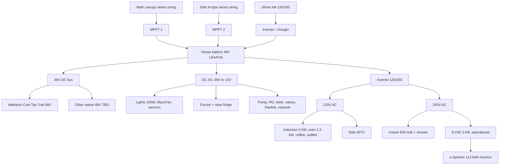

# Electrical Architecture

> Status: `researching`

**Governing ADRs:** [ADR-0002](../05-decisions/0002-mercedes-e-sprinter-platform.md) · [ADR-0003](../05-decisions/0003-all-electric-house-systems.md) · [ADR-0004](../05-decisions/0004-48v-house-dc-bus.md)

## Design goals

- Target off-grid nights: ~3 without want
- Shore power: **50A RV socket** on the van (120/240V) into the house inverter/charger. A **30A pedestal uses an adapter** into that socket. A second exterior socket is **J1772 into the house battery** (campsite or home EVSE). Traction charging stays on the Mercedes port at the front.
- Home charge (traction): Level 2 **11.5 kW** already owned; DCFC on road trips. **One EVSE, shared.** Overnight it charges the drive battery **or** the house bank, not both at once
- House storage: **separate 48V** LiFePO₄ bank (or solid-state later) — not the 113 kWh drive battery
- **48V DC** house battery. The fridge is 12V via DC-DC. The heat pump is the **Webasto Cool Top Trail 48V** on that bus
- Inverter/charger: **120V + 240V** AC output — cooking and most appliances on 120V; **instant HW** on 240V. A **3 kW** portable EVSE from that 240V output into the Mercedes port is aspirational ([requirements](../01-van/requirements.md))
- Solar PV: a **continuous canopy** over the ~160" usable roof, bridged over the Webasto on high-bar risers. Target is a moderate-use day replaced by the roof. Shore power is the backup. **Hood solar is in scope** if it can live with hood heat and the wipers. Long-trip surplus also comes from **deployable solar on the trailer**
- **Dual MPPT:** a main series string on the clear runway, and a second isolated string of narrow N-type panels in the side gaps beside the Webasto. Controllers must deliver a charge **Vmp of about 58–65 V** into the 48V bank. See [Solar canopy](#solar-canopy-dual-mppt)
- Solar thermal: deployable parabolic collector on the **trailer** preheats the van warm-water tank (see [water](water.md))
- Trailer inlet: dedicated van-wall socket → **DC-DC into the 48V house bank**. Trailer batteries and MPPT stay on the trailer
- House battery kWh is **not locked**. **12–15 kWh** nameplate is a payload ceiling only, written before the full load inventory. High-desert evening cooling is still a **trailer + deployable solar** trip ([daily energy budget](daily-energy-budget.md))
- Surplus solar into the traction battery is **aspirational**: when the house bank is full, house inverter **240V**, max **3 kW**, into a portable Level 2 EVSE plugged into the Mercedes charge port under the front logo. No under-hood connection. Traction power does not feed the house. Finishing the van does not include this path
- Controls power for tank sensors + electric dump valves (app) — see [connectivity](../03-features/connectivity/README.md)

## Voltage domains

| Domain | Used for |
|--------|----------|
| **48V DC** | House battery bus. **Webasto Cool Top Trail** heat pump |
| **12V DC** | Lights (**100 W** installed), Furrion fridge, wine fridge, pump, toilet, valves, sensors, Starlink, Wi-Fi, Weboost, MaxxFan, jacks, and the small rechargeables. A few of these may move to 48V if a native part exists |
| **120V AC** | Induction **3,000 W**, combo oven **1,500 W**, coffee maker **1,500 W**, and the other outlet loads in the inventory |
| **240V AC** | Instant electric water heaters (sink + shower). The **3 kW** EVSE that feeds the Mercedes charge port is aspirational |

## Block diagram

\* Solid-state house cells OK if practical at build time.

## Solar canopy (dual MPPT)

The 48V bank wants a charge **Vmp of about 58–65 V**. One mismatched string that shadows would throttle the whole array, so the canopy is two zones:

| Zone | Where | Panels | Wiring | Controller |
|------|-------|--------|--------|------------|
| **1 — main runway** | The clear **~115.9"** of length that is not under the Webasto | Large residential-grade 12V or 24V panels | One **series** string. Combined **Voc about 72–144 V** | **MPPT #1** (heavy lifter) |
| **2 — side channels** | The ~9.5" lateral gaps on either side of the Webasto, on lower crossbars | **2×** narrow high-voltage N-type modules (Renogy ShadowFlux / BougeRV 24V–48V class). Each panel **Voc ≈ 45–50 V** | Series down one side channel → combined **Vmp ≈ 75 V**, **Voc ≈ 90–100 V** | **MPPT #2** (e.g. Victron SmartSolar 100/20) |

Zone 2 exists because the **8.8"** Webasto shroud casts moving shadows into those side gaps. Keeping that string on its own MPPT means partial shade on the sides never pulls down Zone 1’s amps. Rack clearance and the front fairing: [exterior](../03-features/exterior/README.md). Stacking heights: [climate](climate.md).

## Known major loads (direction)

| Load | Power domain | Notes |
|------|--------------|-------|
| Heat pump | **48V DC** — **Webasto Cool Top Trail 48V** | Cool 12.3k BTU / heat 11.6k BTU. Nominal **0.80–1.40 kW**, peak **1.50 kW**, soft start. Energy: [daily energy budget](daily-energy-budget.md) |
| Cabin lights | **12V DC** | **100 W** installed, puck and ambient |
| Fridge / freezer | **12V DC** via DC-DC | **Furrion Arctic 10.7**, plus a slim wine / beer fridge (Wh/day TBD) |
| 2-burner induction | 120V AC | **3,000 W** nameplate. Indoor, and it can move to the exterior outlet |
| Microwave / convection / air fryer | 120V AC | **1,500 W** on one dedicated circuit |
| Coffee maker | 120V AC | **1,500 W**. Keurig K-Slim / K-Mini or Nespresso. Plumbed |
| Instant electric HW (×2) | **240V AC** | Sink + shower; solar thermal preheat reduces duty |
| EVSE to traction port | **240V AC, 3 kW max** | **Aspirational.** Only when the house bank is full. Portable Level 2 into the Mercedes port |
| Exterior AC outlet | 120V AC | GFCI on the side. Grill and other outdoor plugs |
| Starlink | 12V list | **75 W** average, **112 W** peak, on whenever the van is occupied (~1.8 kWh/day at the dish) |
| Demand pump, RO, dump valves, tank sensors | 12V list | RO’s home (van vs trailer) is still the trailer page |
| Fill filter + UV (**GoBluTech AR3**) | **12V ~1 A**, through a buck-boost to **12.0–12.5 V** | On the fill manifold, before the fresh tank. Flow-sensor UV, low standby. Not a 120V dedicated circuit |
| Off-grid draft pump | **12V** | Manual transfer pump into the fill manifold for lakes / jerry cans |
| Marine electric toilet | 12V | Macerating electric flush |
| Leveling jacks | 12V list | **500 W**, short duty. Part of finishing the van, not the first trip |
| Front winch | **12V**, if ever | Aspirational. **15,000–18,000 lb** class (WARN M15, ComeUp Walrus 18, Sherpa Steed) with its own battery. Not in the van-completion list |

## Major decisions (links)

| Topic | Status | Doc / ADR |
|-------|--------|-----------|
| No combustion fuels | accepted | [ADR-0003](../05-decisions/0003-all-electric-house-systems.md) |
| Separate house battery | accepted | [ADR-0003](../05-decisions/0003-all-electric-house-systems.md) |
| **48V DC** bus + heat pump + fridge | accepted | [ADR-0004](../05-decisions/0004-48v-house-dc-bus.md) |
| Instant HW on **240V AC** | accepted | [water](water.md) |
| House kWh | open | **12–15 kWh** is a payload ceiling, not a locked size. Inventory is still being turned into Wh/day |
| Fridge **Furrion 12V** via DC-DC | accepted | Dual-swing door. ADR-0004 amended 2026-10-27 |
| Heat pump **Webasto Cool Top Trail 48V** | accepted | Native 48V. The 120V / 1,590 W contender is rejected. [heating-cooling](../03-features/heating-cooling/README.md) |
| Dual-MPPT solar canopy (main series + side N-type) | accepted | Shadow beside the Webasto must not throttle the main string. [exterior](../03-features/exterior/README.md) |
| Surplus house → traction at **3 kW** | aspirational | 240V EVSE into the front charge port when the house bank is full. No under-hood tap. Traction does not backfeed the house. Not part of finishing the van |
| Cabin lights **12V puck and ambient** | accepted | Supersedes the 2026-10-25 native-48V choice. Travel-hardened lights are 12V |
| Inverter may run **sink heat + one burner** | accepted | Shower waits. Continuous rating is whichever is larger: the shower heater alone, or the sink heater plus one induction burner |
| Inverter topology (split-phase 120/240) | open | Must feed 240V EW and 120V cook. The 3 kW EVSE is aspirational and does not size this inverter. kW waits on what may run at once |
| Solar PV panel SKUs and total watts | open | Dual-MPPT layout is locked; watts wait on the daily energy budget |
| Exterior AC circuit | open | GFCI / weatherproof |

## Interfaces

- Depends on: roof layout (PV + thermal stowage + fans), insulation, weight (~2,624 lb payload class)
- Provides to: galley, climate, plumbing (incl. 240V HW, valves, sensors), lights, pumps, devices
