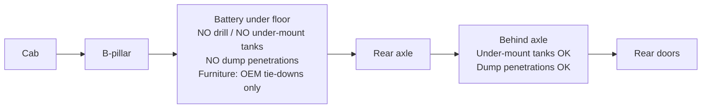

# Layout Architecture

> Status: `researching`

**Governing ADR:** [ADR-0005](../05-decisions/0005-traction-battery-floor-no-drill-zone.md) — traction battery under floor (B-pillar → rear axle) forbids drilling/mounts/tanks in that zone and forces an atypical floor plan.

## Design goals

- Full standing height for 6'2" (thin floor/ceiling stacks)
- Multi-use bathroom (toilet + shower + storage) — convenient transitions
- Wet fixtures drain by **gravity** to under-mount tanks **behind the rear axle**
- Cabinetry in the battery floor span attaches only via **OEM tie-down points**
- Space-efficient, modern, light-weight (vision)

## Hard keep-out (floor)

## Zones (direction)

| Zone | Placement direction | Priority | Notes |
|------|---------------------|----------|-------|
| Wet bath / shower | **Aft** | P0 | Near tanks; gravity drain |
| Galley / sink | **Aft** (near shower) | P0 | Same wet core; sink drains aft |
| Toilet | Aft wet module (multi-use) | P0 | With bathroom feature |
| Sleep / bed | **More forward** | P0 | Elevator bed; lands on settee — [bed-sleep](../03-features/bed-sleep/README.md) |
| Storage | Redesign — **not** classic rear garage | P0 | Side bins, under-bed forward, wall, etc. |
| Lounge / dinette | **Under raised bed** (settee) | P0 | Settee backs = night sleep supports |
| Electrical / technical | TBD | | Respect floor keep-out for penetrations |
| Entry / mud | Sliding door | | Step mounting highly constrained |

## Floor plan direction (accepted)

### Primary concept — “Wet aft / sleep forward”

- Sketch / link: TBD
- **Pros:** Legal/safe vs battery; short drain runs; under-mount tanks package behind axle
- **Cons:** Loses popular rear garage + bed-over-garage; aft becomes wet/galley, not cargo cave
- **Status:** `decided` (direction) — [ADR-0005](../05-decisions/0005-traction-battery-floor-no-drill-zone.md)

### Rejected for this platform — classic rear garage + bed over garage

- Why not: Puts wet drains and/or tank penetrations in conflict with battery zone; long gravity runs forward→aft are poor

## Decided layout

- **Choice:** Kitchen on the **sliding-door / passenger side**. Toilet and shower on the **driver’s side**, aft, gravity-draining to **grey and black tanks on the driver’s side** behind the rear axle. **Fresh tank on the passenger side** behind the axle, to balance that waste weight. Bed **forward of the wet zone**, in the middle of the van, because the aft floor is tanks and the battery span cannot be drilled. Mid-van furniture lands on **OEM tie-downs**
- **Lounge, at the sliding door:** a **full-length settee on the driver’s side**, with **more cabinets** along that wall. On the passenger side, a **short settee across the aft half of the door**, plus the fridge, drawers, and galley. The **forward half of the door is the walk-in**, next to a **fixed bracket just behind the passenger seat** that carries that corner of the bed. When the door is closed, the rest of the passenger settee **slides out for more seats**. The slide-out does **not** carry the bed. By day the two sides face each other across a **center aisle**
- **House battery:** under the long driver’s settee, on OEM tie-downs. The cushion lifts off for service. This side sits opposite the passenger-side fresh tank
- **Clothes:** **80–90%** in drawers on the driver’s side, in the cabinet run aft of the settee. About **4–6 hangers** for shirts and jackets live at the **front of that cabinet run** (shirt-and-jacket height only), so they don’t push the 80" settee aft of the bed bracket.
- **Aisle:** by day the facing settees leave a **center hallway**. At night the bed lowers over it. You get off at the **foot** and walk aft between the galley and the toilet. No assigned sleep sides
- **Fore-aft, driver’s wall:** seat, then an **~80" settee** (queen mattress; the frame may run to ~84"), then food/clothes cabinets, then the toilet/shower in the rear corner. The 4–6 hangers sit at the **front of those cabinets**, not as a block between the seat and the settee, so the bed stays lined up with the bracket.
- **Fore-aft, passenger wall:** seat, **bed-corner bracket**, **sliding-door walk-in**, **short settee ending with the bed**, then the **fridge cabinet** (fridge plus the microwave / air-fryer / toaster), a **small storage cabinet** if the inches remain, then the **galley**: induction inset, sink and faucet, drawers below, narrow uppers, Tern window behind the cooktop.
- **Length check:** Mercedes lists the 170" cargo bed at **173–174"**. A queen mattress is **80"**, not 84". About **90" of floor** remains. Upfit shelving diagrams give about **155"** of driver wall, so an 80" settee leaves about **75"** of wall for cabinets and the bath. That fits a **combined** toilet/shower plus a modest cabinet run, and on the passenger side a ~24" fridge and a compact galley. It does not also fit a separate shower room and a long prep counter. The passenger wheel well (about **36" long, 12" high, ~9" into the room**) should be the galley base. The fridge stays on the flat floor just ahead of it.
- **Table:** drops down; the lowered bed or a cushion covers it
- **Night path:** toilet trips are common. **Head toward the cab, feet toward the toilet.** The walk is off the foot, down the middle, then into the **driver’s-side rear corner**. It must stay easy in the dark and must not require taking the bed apart
- **Windows:** Arctic Tern awning units. One in the wall **behind the long driver’s settee**; one in the **sliding door**; one **behind the induction cooktop**; one in the **passenger rear door**. Optional: one on the driver’s side **forward of the toilet**, with cabinets around it
- **Night zones:** closable **cab** | conditioned **central sleep** | unconditioned **far aft** (galley / bath). The heat pump covers the middle only. The aft close-off still has to let a person through to the toilet
- **Why:** Traction battery floor keep-out; short gravity runs from the driver-side wet fixtures; fresh weight opposite the waste tanks; factory HVAC stays in the cab
- **ADR:** [ADR-0005](../05-decisions/0005-traction-battery-floor-no-drill-zone.md)

## Cabinetry attach rules

| Floor region | Allowed attach method |
|--------------|----------------------|
| B-pillar → rear axle | **OEM tie-down points only** — design layout to those holes |
| Behind rear axle | Controlled drilling OK for tank plumbing penetrations (still thoughtful/sealed) |
| Walls / ceiling / rib structure | Prefer structure other than battery floor when possible |

## Related features

- [Bed / sleep](../03-features/bed-sleep/README.md)
- [Galley](../03-features/galley/README.md)
- [Bathroom](../03-features/bathroom/README.md)
- [Storage](../03-features/storage/README.md)
- [Floor & subfloor](../03-features/floor-subfloor/README.md)
- [Plumbing](../03-features/plumbing/README.md) / [water](water.md)
- [Exterior](../03-features/exterior/README.md) — sliding-door step notch
