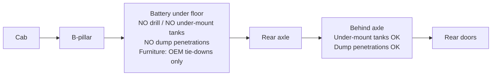

# Layout Architecture

> Status: `researching`

**Governing ADR:** [ADR-0005](../05-decisions/0005-traction-battery-floor-no-drill-zone.md) — traction battery under floor (B-pillar → rear axle) forbids drilling/mounts/tanks in that zone and forces an atypical floor plan.

## Design goals

- Full standing height for 6'2" (thin floor/ceiling stacks)
- Multi-use bathroom (toilet + shower + storage) — convenient transitions
- Wet fixtures drain by **gravity** to under-mount tanks **behind the rear axle**
- Cabinetry in the battery floor span attaches only via **OEM tie-down points**
- Space-efficient, modern, light-weight (vision)

## Hard keep-out (floor)

## Zones (direction)

| Zone | Placement direction | Priority | Notes |
|------|---------------------|----------|-------|
| Wet bath / shower | **Aft** | P0 | Near tanks; gravity drain |
| Galley / sink | **Aft** (near shower) | P0 | Same wet core; sink drains aft |
| Toilet | Aft wet module (multi-use) | P0 | With bathroom feature |
| Sleep / bed | **More forward** | P0 | Not over a rear garage |
| Storage | Redesign — **not** classic rear garage | P0 | Side bins, under-bed forward, wall, etc. |
| Lounge / dinette | TBD (may convert with bed) | | |
| Electrical / technical | TBD | | Respect floor keep-out for penetrations |
| Entry / mud | Sliding door | | Step mounting highly constrained |

## Floor plan direction (accepted)

### Primary concept — “Wet aft / sleep forward”

- Sketch / link: TBD
- **Pros:** Legal/safe vs battery; short drain runs; under-mount tanks package behind axle
- **Cons:** Loses popular rear garage + bed-over-garage; aft becomes wet/galley, not cargo cave
- **Status:** `decided` (direction) — [ADR-0005](../05-decisions/0005-traction-battery-floor-no-drill-zone.md)

### Rejected for this platform — classic rear garage + bed over garage

- Why not: Puts wet drains and/or tank penetrations in conflict with battery zone; long gravity runs forward→aft are poor

## Decided layout

- **Choice:** Shower + kitchen toward the **rear**; bed **farther forward**; under-mount water tanks and dump penetrations **only behind rear axle**; mid-van furniture lands on **OEM tie-downs**
- **Why:** Traction battery floor keep-out
- **ADR:** [ADR-0005](../05-decisions/0005-traction-battery-floor-no-drill-zone.md)

## Cabinetry attach rules

| Floor region | Allowed attach method |
|--------------|----------------------|
| B-pillar → rear axle | **OEM tie-down points only** — design layout to those holes |
| Behind rear axle | Controlled drilling OK for tank plumbing penetrations (still thoughtful/sealed) |
| Walls / ceiling / rib structure | Prefer structure other than battery floor when possible |

## Related features

- [Bed / sleep](../03-features/bed-sleep/README.md)
- [Galley](../03-features/galley/README.md)
- [Bathroom](../03-features/bathroom/README.md)
- [Storage](../03-features/storage/README.md)
- [Floor & subfloor](../03-features/floor-subfloor/README.md)
- [Plumbing](../03-features/plumbing/README.md) / [water](water.md)
- [Exterior](../03-features/exterior/README.md) — sliding-door step notch
