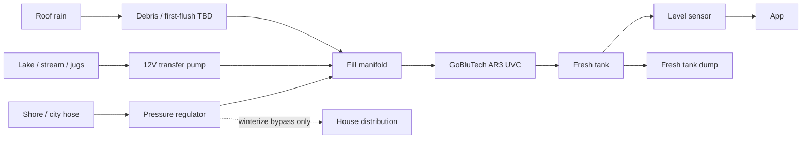
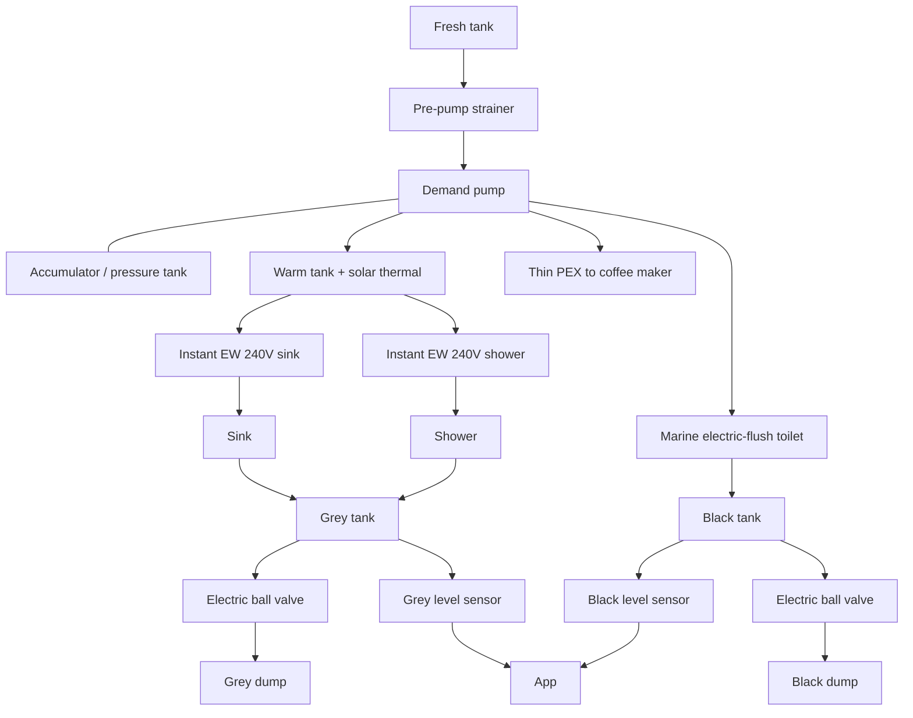

# Water Architecture

> Status: `researching`

**Governing ADRs:** [ADR-0003](../05-decisions/0003-all-electric-house-systems.md) (all-electric HW) · [ADR-0005](../05-decisions/0005-traction-battery-floor-no-drill-zone.md) (battery floor keep-out → tanks/penetrations aft only).

## Design goals

- Fresh tank: an **interior over-wheel-well** tank on the **passenger** side, inside the galley base (not an under-floor tank, so it does not drill the battery span). Stock Sprinter shape is about **20–22 gal** (S&B and others, ~44.5" × 12.5" × 16", level top). A **35 gal** passenger-side version (~46" × 13.5" × 20") is the chosen tank. It is the one in the ~30–40 gal band, and it is what a trailer-less 3 days is sized on (toilet, sink, and coffee on the first trip; navy showers later). The trailer’s extra ~15 gal does not count when the trailer stays home. Grey and black stay **under the floor, driver side, behind the axle**.
- Waste tanks match that fresh supply: **grey + black = 35 gal**. Reverse osmosis on the trailer turns grey back into fresh, and the reject returns to a waste tank, so the van never needs more waste volume than the water it started with. The split is about **3:1 grey to black** — **~26 gal grey** and **~9 gal black**. That is the common DIY ratio when the two waste tanks together equal fresh, and it fits a low-flow marine toilet, which sends much less water to black than a residential RV flush. A 60/40 split (~21 / ~14) would oversize black and steal capacity from grey, which is the tank that fills first. If the toilet we buy uses more than about a quart a flush, black grows and grey shrinks, and the sum stays 35.
- **Under-mount tanks only behind the rear axle** — none under the B-pillar→axle battery span
- Grey/black **dump line floor penetrations only behind the rear axle**
- Wet fixtures (**sink + shower**) placed **aft** for gravity drain into those tanks ([layout](layout.md))
- Grey / black: dump via **app-controlled electric ball valves**
- Black handling: **low-flow marine electric-flush toilet**
- Hot water: **240V instant electric** at sink and shower + **warm tank** preheated by the **trailer’s deployable parabolic solar heater** (flexible mirror, black pipe at the focal line, hoses to a side **quick-connect**). Instant HW and the shower are post-MVP; the socket and tank stay in the plan
- Fill flexibility: **pressurized** city/camp water **and** an **off-grid draft** (lakes, streams, jerry cans) through a shared fill manifold
- Rain: capture from roof → debris / first-flush → the same fill manifold
- **Fill-side purification:** every path into the fresh tank goes through a **GoBluTech PURBLU AR3 UVC** (12V, ~1 A). No raw water enters the tank
- Monitoring: **electric level sensors** on fresh, grey, and black (app-visible)
- Fresh tank: dedicated **empty / winterize** path, plus AR3 **bypass** and **filter inline** valves so a shore-inlet air blow-out can purge the house lines and the UV chamber
- Outdoor rinse: the **same** post-MVP handheld as the stall. A second hook on the back of the van, used with the driver’s rear door open and a platform on the ground ([bathroom](../03-features/bathroom/README.md))
- Solar-thermal loop fluid (potable water vs glycol): **deferred** until the warm tank is designed
- Winterize: **regulated compressed air** through the shore inlet (30–40 PSI). No RV antifreeze. Matches a mild / coastal off-season park
- Service: AR3 canisters surface-mounted with clear wrench radius (vision: maintainability)
- Distribution piping: **PEX-A** throughout (flexible, easy install/repair)
- Convenience: dedicated small **PEX feed to coffee maker** from the pressurized clean-tank loop (no manual jug filling)

## Piping

| Choice | Detail |
|--------|--------|
| Material | **PEX-A** for all fresh pressurized water lines (and related distribution as designed) |
| Why | Ease of installation, flexibility in a van, easy repairability |
| Fittings | Expansion / brand system TBD — stay consistent for serviceability |
| Special run | **Very thin** dedicated line to the **coffee maker** off the pressurized clean-tank loop |

Grey/black drain lines are separate (not PEX drinking distribution) — materials TBD.

## Tank & penetration placement (platform constraint)

| Item | Allowed location | Forbidden |
|------|------------------|-----------|
| Fresh tank | **Inside**, on the **passenger wheel well**, in the galley base | Not under the battery floor |
| Grey / black tanks | **Under the floor, behind the rear axle, driver’s side** | Under floor from B-pillar → rear axle |
| Grey/black outlet lines through floor | **Behind rear axle** | Through battery-zone floor |
| Sink / shower drains | Short gravity runs to aft tanks. Toilet and shower on the **driver’s side**, grey and black tanks on that same side. Galley sink is on the **passenger side**; its drain crosses to the driver-side grey tank behind the axle | Long forward wet core that fights ADR-0005 |

If aft under-mount packaging proves impossible, revisit **in-cabin** tanks as a fallback (see ADR-0005 alternatives) — do **not** drill the battery floor.

## Intake paths (into fresh tank)

**Rule:** no raw water enters the fresh tank. Every fill path hits the **GoBluTech PURBLU AR3 UVC** first. That keeps biofilm and algae out of the tank, and it keeps the filter and UV out of the house demand-pump loop so sink and shower flow stay high.

| Path | Use case | Notes |
|------|----------|-------|
| **Pressurized fill (Line A)** | Campground / city hose | Exterior shore inlet → pressure regulator → fill manifold → AR3 → tank. Never blow an unregulated hose into the tank |
| **Off-grid draft (Line B)** | Lakes, streams, jerry cans | Manual **12V** submersible / marine transfer pump pushes into the same fill manifold → AR3 → tank |
| **Roof rain** | Eco / off-grid top-up | Gutters → debris / first-flush (still open) → fill manifold → AR3 → tank |

### Fill treatment — GoBluTech PURBLU AR3 UVC

| Stage | Role |
|-------|------|
| 1 | **5-micron** sediment |
| 2 | Granular activated **coconut-shell carbon** |
| 3 | High-flow **0.2-micron** bio-contaminant filter |
| 4 | Solid-state **UVC LED** chamber, flow-sensor instant-on, ultra-low standby |

- **Voltage:** native **12V DC**, about **1.0 A** while active. Feed through an inline **buck-boost** that holds **12.0–12.5 V**, so house-battery charge spikes (up to ~14.4 V) do not hit the UV electronics
- **Form:** compact **5-inch** canisters, flat-mounted where a filter wrench has a clear radius. This van has no rear garage; the mount lives in an **aft wet-core service bay** (near the passenger fresh tank / galley base, or another reachable aft panel). Exact panel is still open
- **Winterize valves:** two manual positions. **Bypass** isolates the AR3 and lets the shore inlet feed house distribution. **Filter inline** is normal fill (and the short UV-chamber air blast). Bypass is not a fill shortcut — untreated shore water still cannot reach the tank. See [Winterize](#winterize-fresh-side)

## Pressurized distribution (tank → fixtures)

The tank already holds treated water. The house loop only needs a strainer, the demand pump, and an accumulator. Distribution is **PEX-A**.

| Piece | Role |
|-------|------|
| Pre-pump strainer | Protect the demand pump from anything that settled in the tank. **Quick-connect** at the pump inlet so winterize can pull it off and bump the pump dry |
| Demand pump | Pressurize the house loop |
| Accumulator | Steadier pressure; fewer pump cycles |
| Thin PEX to coffee | Treated tank water, no jug fill |

A second medium / fine / UV train after the demand pump is **not** in this design. Purification happens once, on the way into the tank.

## Hot water

- Instant electric at **sink** and **shower** — product class is **240V** (high power; 120V units are not adequate for real flow/temp rise)
- Warm storage tank preheated by deployable **solar thermal** to cut instant-EW runtime/energy
- **Side-of-van quick-connect** for a deployable **water or glycol** solar thermal collector, plumbed to the warm/hot water tank/heater loop (post-MVP convenience detail; see [requirements](../01-van/requirements.md))
- Loop fluid (potable water vs glycol) waits on the warm-tank design. Freeze and contamination trade-offs stay open on purpose
- Electrical implication: house AC plant must provide **240V** (split-phase / dual inverter / suitable inverter-charger) — see [electrical](electrical.md)

## Tank monitoring & remote dump

| Tank | Level monitor | Empty / dump |
|------|---------------|--------------|
| Fresh | Electric level sensor → app | Dedicated **drain / winterize** path (low-point empty); not the same as grey/black sewer dump |
| Grey | Electric level sensor → app | **Electric ball valve** → dump hose/outlet; **app open/close** |
| Black | Electric level sensor → app | **Electric ball valve** → dump hose/outlet; **app open/close** |

Controls / telemetry live under [connectivity](../03-features/connectivity/README.md) + plumbing firmware/wiring. Fail-safes TBD (manual override if app/power fails; valve default state).

## Toilet & waste

| Item | Direction |
|------|-----------|
| Toilet | **Regular low-flow marine electric-flush** |
| Flush water | From the pressurized clean-tank loop |
| Black water | Black tank → app-controlled electric ball valve → dump |
| Grey water | Sink + shower → grey tank → app-controlled electric ball valve → dump |

Electric flush load is a house-electrical consumer (voltage domain TBD — often 12V; confirm product vs 48V bus / DC-DC).

## Rain capture notes

- Aligns with eco-friendly vision; still needs convenient deploy/stow of any movable bits (vision: ultra-convenient or omit)
- Rain is **drinking water after the AR3**, on the same path as shore and draft water. It is not drunk off the roof. A debris / first-flush stage before the fill manifold is still open
- Roof layout must coexist with solar PV, solar thermal stowage, fans, and heat pump exterior bits — see [exterior](../03-features/exterior/README.md)

## Winterize (fresh side)

Seasonal storage uses **regulated compressed air**. That fits a mild / coastal off-season park (coastal California, and this van’s good-weather design). Skipping antifreeze keeps the taste out of the lines and makes spring start a fill-and-bleed. Design weather stays above about 40°F; leaving the van in a hard freeze is still open.

Air enters at the **exterior shore / city inlet**. That port uses standard city-water thread so a brass RV blow-out plug (Schrader or 1/4" quick-connect) threads on. A compressor with an adjustable regulator supplies the air. **30–40 PSI maximum.** More than that can split joints, blow push fittings, or tear the demand-pump diaphragms.

The inlet has to do two jobs, and they must not cross:

| Valve position | What it connects | When |
|----------------|------------------|------|
| **Filter inline** | Shore, draft, and rain → AR3 → fresh tank | Every fill. Also a 10–15 second air blast to clear the UV chamber |
| **Bypass** | Shore inlet → house distribution, AR3 isolated | Fixture blow-out |

Bypass feeds the faucets only. A check keeps blow-out air, and any hose on that inlet, out of the fresh tank. Every fill still goes through the AR3.

### Blow-out

1. **Depressurize.** Pump off. Open the kitchen faucet and shower valves until the lines are slack.
2. **Bypass.** Set the manual ball valves to bypass so the AR3 is isolated from the house lines.
3. **Empty the canisters.** Towel under the AR3. Unscrew the three 5-inch bowls. Dump them. Pull the 5-micron sediment, carbon, and 0.2-micron cartridges. Dry them indoors (about 5–7 days), then bag them. Screw the **empty** bowls back on so the manifold is a sealed circuit for the UV blast. The mount needs a clear wrench radius for this.
4. **Connect air.** Thread the blow-out plug into the shore inlet. Regulate the compressor to **30–40 PSI**.
5. **Purge one fixture at a time.** Open a valve, wait until it spits only air, close it, then the next:
   - Kitchen hot, then kitchen cold
   - Shower hot, then shower cold
   - Outdoor rinse
   - Coffee-maker stub and the toilet flush, same rule — they are on the pressurized loop and would otherwise hold water
   Hot-side air passes the warm tank and the instant heaters, so those parts have to accept ≤40 PSI air or have their own drain.
6. **Clear the UV chamber.** With air still on, switch to **filter inline** for **10–15 seconds**. Air through the empty bowls breaks the water film in the UVC quartz chamber and dumps into the fresh tank. Return the valves to **bypass**.
7. **Empty the tank and the pump.** Open the fresh-tank dump and drain it. Disconnect the quick-connect inlet strainer and run the pump **5–10 seconds** to push the pocket of water out of the pump body.
8. **Low points.** Open the dedicated low-point drains and **leave them open** for the winter.

### Spring

Put the dry cartridges back in and check the O-rings. Close the low-point drains and the tank dump. Fill the tank, set the valves to **filter inline**, turn the pump on, and run the faucets about **2 minutes** to bleed air.

## Major decisions (links)

| Topic | Status | Doc / ADR |
|-------|--------|-----------|
| Instant electric at sink + shower | accepted | [ADR-0003](../05-decisions/0003-all-electric-house-systems.md) |
| Instant EW voltage **240V** | accepted (direction) | this doc + [electrical](electrical.md) |
| Solar thermal → warm storage tank | accepted | [ADR-0003](../05-decisions/0003-all-electric-house-systems.md) |
| Side quick-connect for deployable thermal (water/glycol) | proposed | this doc + [requirements](../01-van/requirements.md) |
| Fill-side **GoBluTech AR3 UVC** (no raw water in the tank) | accepted | this doc · handoff 2026-10-27 |
| Dual fill manifold (shore + 12V draft pump) + rain into the same manifold | accepted | this doc |
| AR3 on **12V** with buck-boost (12.0–12.5 V) | accepted | this doc + [electrical](electrical.md) |
| No second filter/UV train after the demand pump | accepted | Purification is fill-side only |
| Distribution piping **PEX-A** | accepted | this doc |
| Thin PEX feed to coffee maker | accepted | this doc + [galley](../03-features/galley/README.md) |
| Accumulator / pressure tank | accepted | this doc |
| Roof rain → AR3 → **drinking water** | accepted | this doc |
| Winterize by **compressed air** at the shore inlet, **30–40 PSI**, no antifreeze | accepted | this doc · handoff 2026-10-27 |
| AR3 valves: **bypass** (fixture blow-out) and **filter inline** (fill + UV blast) | accepted | this doc · handoff 2026-10-27 |
| Electric level sensors on fresh/grey/black | accepted | this doc |
| App-controlled electric ball valves (grey + black dump) | accepted | this doc |
| Fresh tank dump + low-point drains left open for the winter | accepted | this doc · handoff 2026-10-27 |
| Low-flow marine electric-flush toilet + black tank | accepted | [bathroom](../03-features/bathroom/README.md) |
| Under-mount tanks + dump penetrations **aft of rear axle only** | accepted | [ADR-0005](../05-decisions/0005-traction-battery-floor-no-drill-zone.md) |
| Wet core (sink/shower) aft for gravity | accepted | [layout](layout.md) |
| Fresh tank **~35 gal** | accepted | Passenger wheel-well tank inside the galley base. ~292 lb of water at 8.34 lb/gal |
| Grey **~26 gal** + black **~9 gal** | accepted | Sum equals fresh. ~3:1 grey:black. ~217 lb grey water + ~75 lb black water when full |
| Pump voltage (12V vs 48V) | open | [electrical](electrical.md) |
| Valve fail-safe / manual override | open | |
| Rain first-flush / leaf screen before the fill manifold | open | |
| Exact aft panel for the AR3 mount | open | Needs wrench clearance to pull all three 5-inch bowls |
| Hard-freeze storage (below the design-weather floor) | open | Air blow-out is the mild-climate method |

## Related

- [Plumbing feature](../03-features/plumbing/README.md)
- [Bathroom feature](../03-features/bathroom/README.md)
- [Exterior feature](../03-features/exterior/README.md) — rain collection on roof
- [Connectivity](../03-features/connectivity/README.md) — app for levels + valves
- [Electrical architecture](electrical.md) — **240V** instant EW + DC pump/toilet/valves/sensors
