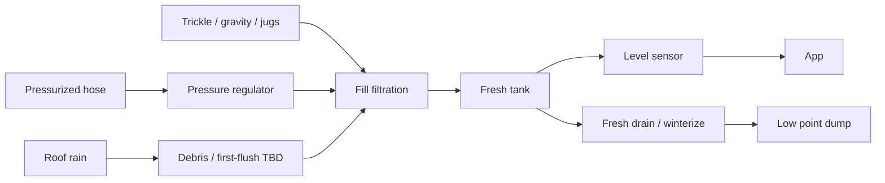
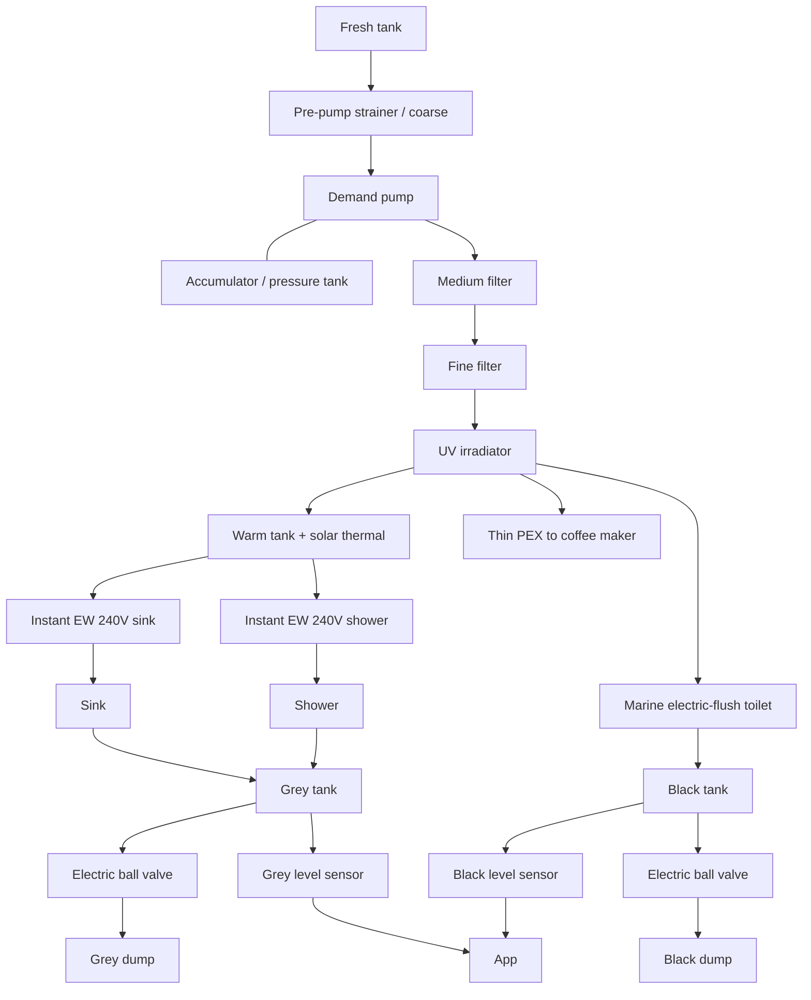

# Water Architecture

> Status: `researching`

**Governing ADRs:** [ADR-0003](../05-decisions/0003-all-electric-house-systems.md) (all-electric HW) · [ADR-0005](../05-decisions/0005-traction-battery-floor-no-drill-zone.md) (battery floor keep-out → tanks/penetrations aft only).

## Design goals

- Fresh tank: an **interior over-wheel-well** tank on the **passenger** side, inside the galley base (not an under-floor tank, so it does not drill the battery span). Stock Sprinter shape is about **20–22 gal** (S&B and others, ~44.5" × 12.5" × 16", level top). A **35 gal** passenger-side version (~46" × 13.5" × 20") is the chosen tank. It is the one in the ~30–40 gal band, and it is what a trailer-less 3 days is sized on (toilet, sink, and coffee on the first trip; navy showers later). The trailer’s extra ~15 gal does not count when the trailer stays home. Grey and black stay **under the floor, driver side, behind the axle**.
- **Under-mount tanks only behind the rear axle** — none under the B-pillar→axle battery span
- Grey/black **dump line floor penetrations only behind the rear axle**
- Wet fixtures (**sink + shower**) placed **aft** for gravity drain into those tanks ([layout](layout.md))
- Grey / black: dump via **app-controlled electric ball valves**
- Black handling: **low-flow marine electric-flush toilet**
- Hot water: **240V instant electric** at sink and shower + **warm tank** preheated by the **trailer’s deployable parabolic solar heater** (flexible mirror, black pipe at the focal line, hoses to a side **quick-connect**). Instant HW and the shower are post-MVP; the socket and tank stay in the plan
- Fill flexibility: **pressurized** city/camp water **and** **trickle** (gravity / slow) fill
- Rain: capture from roof, filter, into fresh system
- Monitoring: **electric level sensors** on fresh, grey, and black (app-visible)
- Fresh tank: dedicated **empty / winterize** path
- Outdoor rinse: the **same** post-MVP handheld as the stall. A second hook on the back of the van, used with the driver’s rear door open and a platform on the ground ([bathroom](../03-features/bathroom/README.md))
- Solar-thermal loop fluid (potable water vs glycol): **deferred** until the warm tank is designed
- Winterize: easy (vision) — drain fresh + protect distribution + heaters as designed
- Service: filters and UV in highly accessible locations (vision: maintainability)
- Distribution piping: **PEX-A** throughout (flexible, easy install/repair)
- Convenience: dedicated small **PEX feed to coffee maker** (no manual jug filling)

## Piping

| Choice | Detail |
|--------|--------|
| Material | **PEX-A** for all fresh pressurized water lines (and related distribution as designed) |
| Why | Ease of installation, flexibility in a van, easy repairability |
| Fittings | Expansion / brand system TBD — stay consistent for serviceability |
| Special run | **Very thin** dedicated line to the **coffee maker** after the drinking-water treatment train |

Grey/black drain lines are separate (not PEX drinking distribution) — materials TBD.

## Tank & penetration placement (platform constraint)

| Item | Allowed location | Forbidden |
|------|------------------|-----------|
| Fresh tank | **Inside**, on the **passenger wheel well**, in the galley base | Not under the battery floor |
| Grey / black tanks | **Under the floor, behind the rear axle, driver’s side** | Under floor from B-pillar → rear axle |
| Grey/black outlet lines through floor | **Behind rear axle** | Through battery-zone floor |
| Sink / shower drains | Short gravity runs to aft tanks. Toilet and shower on the **driver’s side**, grey and black tanks on that same side. Galley sink is on the **passenger side**; its drain crosses to the driver-side grey tank behind the axle | Long forward wet core that fights ADR-0005 |

If aft under-mount packaging proves impossible, revisit **in-cabin** tanks as a fallback (see ADR-0005 alternatives) — do **not** drill the battery floor.

## Intake paths (into fresh tank)

Three ways to put water in the fresh tank — all go through **fill filtration** before the tank so the tank stays clean.

| Path | Use case | Notes |
|------|----------|-------|
| **Pressurized fill** | Campground / city hose under pressure | Pressure regulator + fill filter → tank; never blow an unregulated hose into the tank |
| **Trickle fill** | Slow / gravity / jerry-can / non-pressurized sources | Separate inlet sized for low flow; same (or parallel) fill filtration → tank |
| **Roof rain capture** | Eco / off-grid top-up | Gutters/collection → rain pre-filter → fill filtration → tank; first-flush / leaf screen TBD |

## Pressurized distribution (tank → fixtures)

Keep the tank clean at fill; protect the pump; treat water under pressure before fixtures. Distribution in **PEX-A**.

### Treatment train (post-pump drinking path)

| Stage | Role |
|-------|------|
| Fill filtration | Keep grit and junk **out of the fresh tank** (intake) |
| Coarse (incl. pre-pump strainer) | Protect pump; remove large particulate |
| Medium filter | Mid particulate / next polish stage |
| Fine filter | Fine particulate / taste polish as specified |
| **UV irradiator** | Inactivate bacteria and viruses (not a particle filter — needs clear water upstream) |
| Accumulator | Steadier pressure; fewer pump cycles |

All filter housings + UV must be in a **highly accessible** service bay (vision: maintainability). UV is an electrical load (often 120V or 12V — product TBD) — see [electrical](electrical.md).

## Hot water

- Instant electric at **sink** and **shower** — product class is **240V** (high power; 120V units are not adequate for real flow/temp rise)
- Warm storage tank preheated by deployable **solar thermal** to cut instant-EW runtime/energy
- **Side-of-van quick-connect** for a deployable **water or glycol** solar thermal collector, plumbed to the warm/hot water tank/heater loop (post-MVP convenience detail; see [requirements](../01-van/requirements.md))
- Loop fluid (potable water vs glycol) waits on the warm-tank design. Freeze and contamination trade-offs stay open on purpose
- Electrical implication: house AC plant must provide **240V** (split-phase / dual inverter / suitable inverter-charger) — see [electrical](electrical.md)

## Tank monitoring & remote dump

| Tank | Level monitor | Empty / dump |
|------|---------------|--------------|
| Fresh | Electric level sensor → app | Dedicated **drain / winterize** path (low-point empty); not the same as grey/black sewer dump |
| Grey | Electric level sensor → app | **Electric ball valve** → dump hose/outlet; **app open/close** |
| Black | Electric level sensor → app | **Electric ball valve** → dump hose/outlet; **app open/close** |

Controls / telemetry live under [connectivity](../03-features/connectivity/README.md) + plumbing firmware/wiring. Fail-safes TBD (manual override if app/power fails; valve default state).

## Toilet & waste

| Item | Direction |
|------|-----------|
| Toilet | **Regular low-flow marine electric-flush** |
| Flush water | From fresh pressurized system (after treatment train as designed) |
| Black water | Black tank → app-controlled electric ball valve → dump |
| Grey water | Sink + shower → grey tank → app-controlled electric ball valve → dump |

Electric flush load is a house-electrical consumer (voltage domain TBD — often 12V; confirm product vs 48V bus / DC-DC).

## Rain capture notes

- Aligns with eco-friendly vision; still needs convenient deploy/stow of any movable bits (vision: ultra-convenient or omit)
- Rain is **drinking water after fill filtration and UV**, on the same path as hose and trickle water. It is not drunk off the roof. A debris / first-flush stage before the fill filters is still open
- Roof layout must coexist with solar PV, solar thermal stowage, fans, and heat pump exterior bits — see [exterior](../03-features/exterior/README.md)

## Winterize (fresh side)

Must be able to **fully empty** the fresh tank and blow down / drain distribution, warm tank, and instant EW per product guidance. Fresh drain/winterize path is a first-class requirement (not an afterthought fitting).

## Major decisions (links)

| Topic | Status | Doc / ADR |
|-------|--------|-----------|
| Instant electric at sink + shower | accepted | [ADR-0003](../05-decisions/0003-all-electric-house-systems.md) |
| Instant EW voltage **240V** | accepted (direction) | this doc + [electrical](electrical.md) |
| Solar thermal → warm storage tank | accepted | [ADR-0003](../05-decisions/0003-all-electric-house-systems.md) |
| Side quick-connect for deployable thermal (water/glycol) | proposed | this doc + [requirements](../01-van/requirements.md) |
| Fill filtration + coarse / medium / fine + **UV** | accepted | this doc |
| Distribution piping **PEX-A** | accepted | this doc |
| Thin PEX feed to coffee maker | accepted | this doc + [galley](../03-features/galley/README.md) |
| Accumulator / pressure tank | accepted | this doc |
| Dual fill (pressurized + trickle) | accepted | this doc |
| Roof rain → fill filters + UV → **drinking water** | accepted | this doc |
| Electric level sensors on fresh/grey/black | accepted | this doc |
| App-controlled electric ball valves (grey + black dump) | accepted | this doc |
| Fresh tank drain / winterize path | accepted | this doc |
| Low-flow marine electric-flush toilet + black tank | accepted | [bathroom](../03-features/bathroom/README.md) |
| Under-mount tanks + dump penetrations **aft of rear axle only** | accepted | [ADR-0005](../05-decisions/0005-traction-battery-floor-no-drill-zone.md) |
| Wet core (sink/shower) aft for gravity | accepted | [layout](layout.md) |
| Fresh tank **~35 gal** | accepted | Passenger wheel-well tank inside the galley base. ~292 lb of water at 8.34 lb/gal |
| Pump voltage (12V vs 48V) | open | [electrical](electrical.md) |
| Valve fail-safe / manual override | open | |
| Rain first-flush / treatment details | open | |

## Related

- [Plumbing feature](../03-features/plumbing/README.md)
- [Bathroom feature](../03-features/bathroom/README.md)
- [Exterior feature](../03-features/exterior/README.md) — rain collection on roof
- [Connectivity](../03-features/connectivity/README.md) — app for levels + valves
- [Electrical architecture](electrical.md) — **240V** instant EW + DC pump/toilet/valves/sensors
