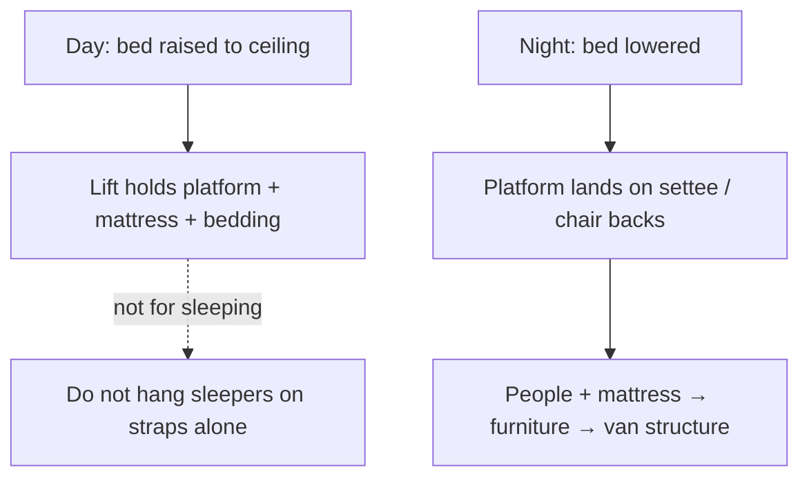
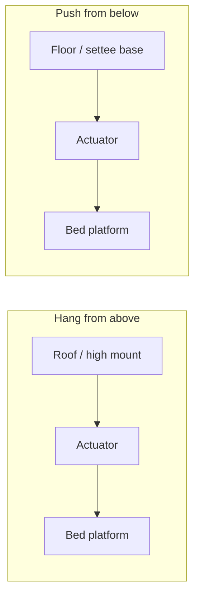
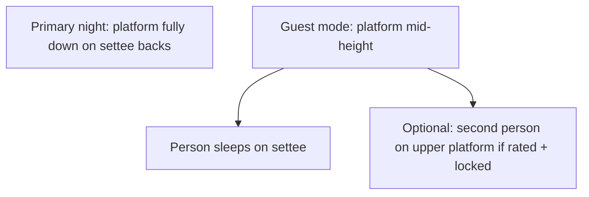
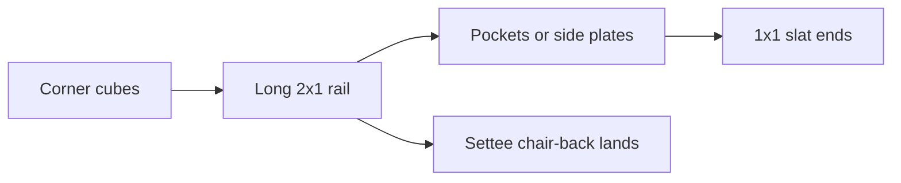

# Feature: Bed / Sleep

> Status: `researching`  
> Priority: `P0`  
> Jira Epic: _TBD (build phase)_  
> Last updated: 2026-10-25

## Summary

Comfortable bed for two (tall sleeper 6'2"). Per [ADR-0005](../../05-decisions/0005-traction-battery-floor-no-drill-zone.md) / [layout](../../02-architecture/layout.md), the bed sits **more forward** — not a rear-garage loft.

**Direction:** **automatic elevator bed** — push-button raise to the ceiling by day; lower onto the **settee / chair backs** at night so the sleep platform is mechanically stable (no hanging swing).

## Goals

- “Really comfortable bed” success criterion from vision
- **North–south** sleep for 6'2" (east–west length won’t fit); mattress as large as practical (**queen-class**)
- Daytime lounge under a raised bed; night bed without rebuilding the cabin
- Push-button raise/lower — including the joy of **hiding an unmade bed** (sheets/pillows stay put; no daily make-up-for-looks)
- Sleep loads borne by **settee structure**, not by straps/actuators alone
- **Very light** platform (carbon / honeycomb class) whose **underside reads as ceiling** (finish + built-in lights)
- Thin mattress (**≤3–4"**) so raised bed doesn’t steal standing headroom
- Mount legally vs battery-zone floor (**OEM tie-downs** / walls / roof structure)

## Non-goals

- Primary bed over a rear cargo garage (rejected for this platform)
- Sleeping while suspended only on lift belts or actuators
- Riding the bed while it is moving
- East–west sleep for the tall occupant (van too narrow for ~80" length across)

## Requirements

### Must

- Sleeping length suitable for 6'2" → **N–S** orientation
- Forward placement relative to aft wet core (shower/galley)
- **Electric push-button** raise toward ceiling and lower to sleep height
- At sleep height, platform **settles onto settee / chair-back supports** (positive stop / land)
- Lift system has a **manual lower** path if power fails
- Floor attaches in mid-van only via **tie-downs** (or non-floor structure for rails/brackets)
- Platform + mattress light enough for payload ([payload budget](../../02-architecture/weight-and-balance.md))
- Mattress thickness **≤4"** (prefer **~3"**) for ceiling-stow headroom
- Raised underside finished as a **ceiling plane** (lights OK; tidy with bedding aboard)

### Should

- Obstacle / over-current stop (don’t crush settee or ceiling)
- Quiet enough for camp etiquette
- Guides or anti-sway so the platform stays square while traveling up/down
- Keep raised underside high enough that a 6'2" person can still use the lounge without constant head-cracking
- Queen-class footprint (**~60" wide × ~75–80" long**) if wall-to-wall width allows after insulation
- Bedding stays on the platform when raising (straps / corners / low rails) so “unmade” stows cleanly

### Could

- Wireless remote in addition to fixed switch
- Expandable / sliding platform length (some kits: ~63→77")
- Intermediate stop heights (guest settee bunk) — see mid-height notes
- Carbon-fiber / honeycomb sandwich deck; modular CF or hybrid framing

## Design notes

### Sleep vs lift load paths (critical)

Commercial kits (e.g. Tec / RoamLabX) state hanging belts support the **frame in motion / storage**, not sleepers — lower onto cabinets or equivalent before sleeping. Our settee backs **are** that secondary support.

### Settee interface

- Chair backs (or ledges on the settee frame) need a defined **landing height** and enough strength for two adults + dynamic van motion
- Soft pads / locating pins so the platform centers and doesn’t slide when the van rocks
- Lift should **unload** once landed (slight slack or current-limit stop) so the mechanism isn’t fighting the furniture all night

### How synced linear actuators move the bed

A linear actuator is a 12V screw jack in a tube: the rod **extends** or **retracts**. Four identical units (corners) share a **sync control box** (Hall/encoder feedback) so they stay level. **Guide rails** take side loads; actuators should only do vertical work.

Two mount geometries:

| Geometry | Layout | Motion | Lounge impact |
|----------|--------|--------|---------------|
| **Pull / hang from above** | Fixed end on roof or high wall structure; moving end on bed corners | Rod **short** → bed **up** near ceiling; rod **long** → bed **down** | Living space under the bed stays mostly clear of columns; actuator bodies live at the top / beside the mattress |
| **Push from below** | Fixed end on floor or inside settee/bench structure; moving end under bed | Rod **long** → bed **up**; rod **short** → bed **down** | Columns occupy the lounge zone unless hidden inside settee ends / cabinets (common DIY van pattern) |

For **our** layout (settee lounge under a ceiling-stowed bed), **hang-from-above** is usually cleaner. **Push-from-below** only if actuators are packaged inside settee arms/ends so they don’t become four poles in the living room — and that packaging must still leave the settee usable as a guest bunk (see below).

Strap systems (EuroLoft / Tec) are effectively **hang-from-above** (belts from high anchors). HappiJac tracks are **side columns** (neither classic push nor hang — rails on the walls).

### Guest / mid-height mode (settee as spare bed)

Idea: stop the elevator **partway** so someone can sleep on the **settee below**, with the platform parked as an upper bunk or just out of the way.

| System | Stop halfway? | Hold safely mid-travel? | Sleep on settee below? | Sleep on upper platform mid-height? | Watch-outs |
|--------|---------------|-------------------------|------------------------|-------------------------------------|------------|
| **C Actuators** | **Yes** — kits advertise stop-any-height / presets | Yes if worm-drive holds + sync box; **add pins/latches** if someone is underneath | **Yes** — best match if hang-from-above (clear lounge) | Only if load-rated and locked; don’t treat as “settee land” | Push-from-below columns may block settee sleeping space |
| **B HappiJac** | **Yes** — designed for any height | Strong mechanical hold in tracks | **Yes** | Often used as bunk; still respect ratings | Heavy; mid-height still eats headroom for upper + lower |
| **A Strap (EuroLoft / Tec)** | **Usually** with momentary switch | Motor/gearbox can hold; straps are a wear item | **Yes** for settee-below | **Discouraged** for people on hanging straps — same as full-hang sleep | Confirm kit allows intentional mid-stop; add **mechanical mid latches** before anyone sleeps under it |
| **D Cable DIY** | Maybe | Weakest hold story | Possible | No | Stretch / slip risk mid-height |
| **E / F** | Awkward | — | Poor | — | Wrong package for this |

**Design rules if we want guest mode:**

1. Mid-height is a **third position** (not just “stopped randomly”) — measure clearance for a settee sleeper (lie flat + some sit-up).
2. When anyone is under the bed, use **mechanical locks / pins / ledges** at that height — don’t rely only on motor brakes.
3. Upper bunk (person on the half-down platform) is optional and stricter: needs a rated hold path. Prefer **settee guest only** + empty upper platform unless we deliberately engineer an upper bunk.
4. **Push-from-below actuators** are the geometry most likely to **interfere** with a settee guest (poles / housings in the bunk zone). Prefer hang-from-above or wall tracks if guest mode matters.
5. Primary couple sleep remains **fully down on settee backs** — guest mode does not replace that land.

### Mounting vs battery keep-out

- Vertical rails / strap / upper actuator anchors prefer **walls and roof structure**, not mid-van floor bolts
- Push-from-below feet that need floor mounts in the battery span → **OEM tie-downs only** or mount to settee structure that itself lands on tie-downs ([ADR-0005](../../05-decisions/0005-traction-battery-floor-no-drill-zone.md))

### Orientation & size (will a queen fit?)

**North–south** = head/feet along the van length; **width** of the mattress spans side-to-side.

| Dimension | Sprinter cargo (typical) | Queen need | Fit? |
|-----------|--------------------------|------------|------|
| Max width at floor | **~70"** | Queen width **60"** | Yes at floor |
| Width between wheel wells | **~53"** | — | Bed is **above** wells on settee — wells don’t clip a raised platform the same way |
| Width higher up (walls taper) | Often **~58–65"** after panels — **measure** | 60" | **Tight** — insulation/walls may force **short queen / custom ~56–58"** or slim wall build-up |
| Cargo length 170" WB | **~170"** raw | Queen length **80"** (or short queen **~75"**) | Easy along the van |
| East–west length across van | only ~70" max | Need **~80"** for 6'2" | **No** — confirms N–S |

Planning sizes:

| Size | W × L | Notes |
|------|-------|-------|
| Residential queen | 60 × 80 | Target if post-insulation clear width ≥60" |
| RV short queen | 60 × 75 | Common van compromise; still N–S for tall sleeper |
| Custom | measure | Best — cut latex/foam to actual clear width at **bed height** |

**Action:** after wall/insulation mockup, measure clear width at sleep height and at raised-stow height (taper). Don’t buy a residential queen until that number is real.

### Breathable platform (moisture / sweat)

A sealed solid underside traps moisture under a thin mattress. Prefer an **open slat frame** with free airflow, then a **porous or gapped ceiling skin** so the raised bed still looks finished:

| Layer | Role |
|-------|------|
| Mattress (~3" latex) | Comfort; needs to breathe downward |
| Slats (gaps ~2.5–3" O.C.) | Structure + primary airflow |
| Optional open fabric / perforated thin panel | “Ceiling” look when raised — **must not seal** (perforations, mesh, or spaced boards with reveal gaps) |
| Recessed LEDs in perimeter channels | Keep out of airflow path through slat field |

Air path: cabin ↔ gaps between slats ↔ (through perforations) ↔ underside. Skip solid skins, vinyl wraps, or closed foam under the mattress.

### Ultra-light platform + “ceiling” underside

There is **no full carbon-fiber clone of 80/20** with the same cheap T-nut ecosystem. Closest modular options:

| Approach | What it is | Merits | Drawbacks |
|----------|------------|--------|-----------|
| **A. CF sandwich panel deck** | Honeycomb or foam core + carbon (or glass) skins; optional Al/CF edge rails | Best stiffness/weight for a large flat “ceiling”; underside can be gelcoat/paint/fabric + recessed LEDs | Not bolt-together like 8020; edges and inserts need design; DIY epoxy skill or buy panels |
| **B. FFT FibreTEC (industrial)** | Square CFRP profiles + T/L/H/X connectors ([FFT](https://www.fft.de/en/products/connectors)) | True modular CF framing closest to aluminum systems | Industrial pricing/availability; overkill for a bed unless we love the kit |
| **C. DragonPlate / McMaster CF tube + connectors** | Round/square CF tubes + Al slip-on or bonded connectors | Light spaceframes; reconfigurable-ish | Round-tube look; joints are bonded/slip-on, not T-slot continuous adjustability |
| **D. Hybrid: thin 80/20 or Al extrusion perimeter + CF/honeycomb deck** | Al frame for attach points to lift; composite sheet as the plane | Keep lift brackets easy; still save mass on the big panel; T-nuts where handy | Al adds some weight vs all-CF |
| **E. Elevated Materials-style CF plates on Al T-slot** | CF connector plates for 8020 | Cosmetic/weight trim on Al system | Still mostly aluminum mass |

**Practical lean for this bed (updated for breathability):** **DragonPlate-class CF tube frame + slats** (option C), not a sealed sandwich deck. Perimeter rails carry lift loads and land on the settee; cross-slats breathe; a **perforated / mesh ceiling skin** hides the mess when raised.

Sandwich panels (A/D) remain OK only if heavily perforated or used as a **rim** around an open slat field.

### DragonPlate tube sizing (220 + 210 lb sleepers)

**Design load (planning):** people **430 lb** + mattress/bedding ~**35 lb** + van dynamic factor **×1.5** ≈ **~700 lb** distributed. Settee lands carry night load into furniture; the frame must still not fold when hanging from the lift (platform + mattress only) or when someone sits before fully landed.

DragonPlate stock (relevant):

| Tube | Stock lengths | Notes |
|------|---------------|-------|
| Braided **1×1"** square | **24 / 48 / 96"** | Good **slat** candidate; cut 96" → 60–80" |
| Roll-wrapped **1×1"** square | **72"** listed | Thicker wall options; nicer twill |
| Braided **2×1" rectangular** | **24 / 48 / 72 / 96"** | Use with **2" vertical** as **side rails** |
| Braided **2×2"** square | 24 / 48 / 96" | Heavy-duty perimeter if needed |

**Yes — tubes are available well over 60"** (72" and 96" stock). Cut to queen width/length.

#### Will 1" slats hold you?

Rough bending estimates (conservative **~15 ksi** working stress for thin CF; **not** a substitute for a coupon test):

| Member | Role | Unsupported span | Rough center-load capacity (one tube) | Verdict |
|--------|------|------------------|----------------------------------------|---------|
| **1×1"** | Slat | **56"** (full queen clear) | ~**70–150 lb** depending on wall | **Marginal alone** if you sit on one slat midspan |
| **1×1"** | Slat | **36"** (to a center spine) | ~**105–150 lb** | **OK** with mattress load-sharing |
| **1×1"** @ 2.5–3" spacing | Slat field | shared ~700 lb → ~**22–35 lb/slat** average | well below capacity | **OK if many slats + mattress distribute** |
| **2×1" rect, 2" tall** | Long side rail | 48–80" | ~**235–365 lb** midspan (one rail) | **Good perimeter** with two rails + lands |
| **2×2"** | Perimeter / spine | — | higher | Use if spans stay long with few supports |

**Recommendation:**

1. **Perimeter:** **2×1" rectangular** rails on the long sides (**2" dimension vertical**), landing on settee backs.  
2. **Center spine (strongly preferred for queen width):** one N–S rail so slats only span ~**30"** each side — then **1×1" slats** are comfortable.  
3. **Slats:** **1×1"** on **~2.5–3" centers**, length = clear width (cut from **72" or 96"** stock).  
4. **Do not** rely on a few 1" tubes spanning a full ~60" with two adults sitting — short spans + many slats win.  
5. **Prototype:** three-point bend a spare 1" tube at your real slat span before committing the whole bed (DragonPlate expects the user to design/test).

#### How to tee (end of a slat into the middle of a rail)

DragonPlate’s nicest **Tee Joint** is for **round** 1" ID tubes (drill through the continuous tube, bolt, adhesive). Square modular **cubes** join **tube ends at corners**, not a mid-span branch.

Practical mid-span tees for a **square/rect** bed frame:

| Method | How | Merits | Drawbacks |
|--------|-----|--------|-----------|
| **A. End connector + side plate** | Bond threaded end into slat; bolt to Al/CF plate bonded/bolted to side of long rail | Clean; serviceable | Need plate pattern |
| **B. Gusset plates** | CF or Al L/T plates bonding slat end to rail face | Strong, common in composites | More bonding; less “Erector set” |
| **C. Pocket / dado in rail** | Rail has notches; slats drop in (wood-bed style) | Fast assembly; great for slats | Weakens rail if overdone; adhesive/fasteners still needed |
| **D. Switch long members to round + official Tee** | Round rail, Tee Joint, round or adapter to slats | Catalog tee exists | Round rails harder to land flat on settee |
| **E. Tangent Tube Mount** | Bond mount to tube / flat | Good tube-to-plate | Aimed at round↔flat more than square tee trees |

**Lean for slats:** **pocketed long rails (C)** or **end-fitting → side plate (A)** — both keep 1" square slats simple. Use **cubes** at the four corners of the outer frame.

### Thin mattress (≤3–4") that still feels good

At 3–4" you need **high-quality foam/latex**, not a cheap camping pad — and a **flat, supportive platform** (thin mattresses telegraph every slat gap).

| Material | Why it works thin | Watch-outs |
|----------|-------------------|------------|
| **Natural latex (Dunlop/Talalay) 3"** | Bouncy, pressure relief, sleeps cooler, eco-aligned, custom-cut RV sizes (e.g. Turmerry) | Heavier than poly foam; cost |
| **Zoned latex or latex + thin firm base** | Soft top / supportive bottom in ≤4" stack | Layering must stay within height budget |
| **High-density memory foam 3"** | Contours well on hard platforms | Sleeps warmer; off-gas; softens in heat |
| **Gel / copper / graphite memory foam** | Slightly cooler than plain memory foam | Still warmer than latex in a van |
| **Wool / cotton futon-style + 1–2" latex** | Traditional thin sleep; repairable | May need break-in; check loft when compressed |

**Prefer for this build:** **~3" natural latex** (firmness trial), custom-cut to measured platform, with a fitted sheet system that **stays put when the bed rises**. Optional very thin waterproof/cover layer if spills matter — count it in the 4" cap.

Avoid: tall hybrid innerspring (steals headroom, heavy, noisy when raising).

### Unmade-bed UX (a real requirement)

Making the bed “for looks” is explicitly out of scope. The elevator is partly so **messy sheets and pillows disappear into the ceiling** until bedtime.

Implications:

- Corner straps, low lip, or sheet suspenders so bedding doesn’t slide off while raising
- No fragile decor pillows that fall on heads
- Underside still looks like a ceiling even with a rumpled top side hidden above
- Guest mid-height mode: same retention so bedding doesn’t dump onto the settee sleeper

---

## Lift system options (research)

“Jack” here means the powered lift family — not truck-camper ground jacks (HappiJac *camper jacks* are a different product).

### Comparison

| Family | How it works | Examples | Pros | Cons | Fit for our settle-on-settee plan |
|--------|--------------|----------|------|------|----------------------------------|
| **A. Nylon strap / belt (single motor)** | One 12V motor winds 4 belts; straps retract into/near the bed base; guide rails keep it square | Lippert **EuroLoft** / Project 2000; Tec/RoamLabX expandable elevator bed | Relatively light vs chain; quiet; proven in Class B / vans; single motor = natural sync; kits often include frame; emergency release common | Straps wear/fray over years; rated **moving** mass often modest (EuroLoft: whole bed unit ≤~132 lb moving, **800 lb** static capacity when supported); needs good ceiling/wall anchors; raised bed still eats headroom | **Strong fit** — lift for travel of platform; sleep on settee |
| **B. Chain / track columns** | 4 corner tracks with internal chain; motor + drive shaft | Lippert **HappiJac** bed lift | Very robust; holds height well; common in toy-hauler / van builds; push-button | **Heavy** (~200+ lb shipped class before custom bed frame); install is fussy (square/level in curved van); motor bulk under mattress steals ceiling tuck; more mechanical maintenance | Works, but fights **payload** and standing-height stack |
| **C. Synchronized linear actuators (×4)** | One actuator per corner (or per side); Hall/feedback control box keeps them level | **Vanketo** bed lift kit; DIY (e.g. Progressive Automations PA-04-HS class) | DIY-friendly sizing; stop anywhere; no straps; clean look possible; good for custom platform over settee | Sync is mandatory (unsynced = bind/twist); need **guide rails**; actuators hate side loads; 12V surge can be high (Vanketo cites up to ~32 A); failure of one corner is awkward; must still land on settee for sleep | **Good fit** if we want a custom thin platform — budget sync + guides + manual backup |
| **D. Single actuator + cables/pulleys** | One strong actuator (or winch) splits force to 4 corners via cable | DIY / Firgelli-style designs | Fewer motors; potentially lighter electronics | Cable stretch, pulley wear, harder to keep square; more DIY risk; still needs guides + sleep supports | Possible, higher DIY burden |
| **E. Scissor lift** | Horizontal actuator drives scissor linkage | Adjustable beds / shop lifts | Stable geometry; one actuator | Tall stack when raised (fights ceiling stow); heavy; usually wrong for “tuck to roof” | **Poor fit** for ceiling-stow van bed |
| **F. Screw-column jacks** | Acme/ball screw columns at corners | Rare as bed lifts; HappiJac *truck camper* screw jacks are **ground supports**, not bed lifts | Strong, precise | Heavy, slow, overkill, package poorly under roof | **Not preferred** |

### Product sketches (candidates — not chosen)

| Kit | Type | Notes | Approx. mass | Link |
|-----|------|-------|--------------|------|
| Tec / RoamLabX expandable elevator bed | Strap + electric motor | 63×55 → 77×55; **must lower onto secondary supports before sleep**; manual emergency release; ~66 lb kit; 600 lb static rating | ~66 lb | [tecvan.com](https://tecvan.com/products/expandable-elevator-bed) |
| Lippert EuroLoft | Strap, single motor | ~2.3 in/s; OEM-custom sizes; moving bed assembly cap ~132 lb; 800 lb capacity when used as designed | ~108 lb class (reported) | [Lippert support](https://support.lci1.com/euroloft-bed-lift) |
| Lippert HappiJac bed lift | Chain/track | Very stout; heavy; headroom killer if motor not tucked | ~200+ lb shipped class | [Lippert HappiJac](https://www.lippert.com/brands/happijac) |
| Vanketo campervan bed lift kit | 4× 12V linear actuators | Wireless one-button; stop any height; frame not included; 200 kg moving / 400 kg static | ~37 lb (17 kg) kit only | [vanketo.co](https://vanketo.co/products/campervan-bed-lift-kit) |

### Evaluation criteria (our priorities)

Scored **1–5** (5 = best for this van). **Weight is weighted heaviest** because payload is **2,624 lb**.

| Criterion | Why it matters here | Weight in overall |
|-----------|---------------------|-------------------|
| **Weight** | Every lb competes with battery, water, people, gear | **40%** |
| **Ease-of-use** | Vision: ultra-convenient or omit — push-button, no fuss | **15%** |
| **Ease of repair / replacement** | Travel + DIY maintainability; stuck bed is bad | **20%** |
| **Reliability** | Daily cycle for years; failure modes must be survivable | **25%** |

#### Scores by family

| Family | Weight | Ease-of-use | Repair / replace | Reliability | **Weighted** |
|--------|--------|-------------|------------------|-------------|--------------|
| **A. Nylon strap** (EuroLoft / Tec) | 4 | 5 | 4 | 4 | **4.15** |
| **C. Synced linear actuators** (Vanketo / DIY) | 5 | 5 | 5 | 3 | **4.40** |
| **B. Chain / track** (HappiJac) | 1 | 5 | 3 | 5 | **3.20** |
| **D. Single actuator + cables** | 4 | 3 | 2 | 2 | **2.95** |
| **E. Scissor** | 2 | 3 | 2 | 3 | **2.45** |
| **F. Screw columns** | 1 | 3 | 2 | 4 | **2.25** |

Score notes:

- **Weight:** C kit alone is lightest (~37 lb) but needs a platform; A Tec ~66 lb with frame; A EuroLoft ~108 lb class; B ~200+ lb before mattress — disqualifying on payload unless everything else is heroic.
- **Ease-of-use:** A/B/C commercial kits are all one-button. D depends on DIY polish. E/F are awkward for ceiling stow even if the switch is simple.
- **Repair / replace:** C wins — actuators are commodity; swap one corner. A: replaceable straps + single motor (Lippert/Tec parts). B: parts exist but tracks/chains are a bigger job. D: cable stretch and DIY tuning are painful on the road.
- **Reliability:** B is the tank. A is OEM-proven with a simple sync story (one motor) but straps are a wear item. C is fine when guides + feedback sync are done right, but has **four** electromechanical failure points and sync risk. Settle-on-settee helps all of them (lift isn’t the sleep structure).

#### Ordered shortlists

**By weight alone (best → worst):**  
1. C actuators → 2. A strap (Tec-class) → 3. A strap (EuroLoft-class) ≈ D → 4. E → 5. B ≈ F

**By ease-of-use alone:**  
1. A ≈ B ≈ C (kit) → 2. D → 3. E ≈ F

**By repair / replacement alone:**  
1. C → 2. A → 3. B → 4. D → 5. E ≈ F

**By reliability alone:**  
1. B → 2. A → 3. C → 4. F → 5. E → 6. D

**Overall for *this* van (weight-biased):**  
1. **C — synced linear actuators** — lightest path; easiest parts swap; reliability OK if guides + sync box + settee land are solid  
2. **A — nylon strap kit** — close second; slightly heavier; excellent everyday simplicity; one-motor sync; proven; straps are the wear item  
3. **B — HappiJac chain/track** — most reliable mechanism, but **fails the weight criterion** hard unless payload math somehow opens up  
4. **D — cable DIY** — only if we enjoy fabricating; worse repair/reliability story  
5. **E / F** — eliminate for ceiling-stow elevator bed

### Recommendation (still not purchased)

**Primary shortlist: C or A.**  
- Pick **C** if we want minimum mass and are willing to own sync/guides carefully.  
- Pick **A** if we want the most “appliance-like” kit with fewer moving electronics.  
- **Do not pick B** unless a future weigh-in shows unexpected payload headroom — reliability doesn’t help if we’re over GVWR.

**Must-have regardless of family:** guide/anti-racking, manual lower, land-on-settee sleep path, 12V from house DC-DC, weight logged in [payload budget](../../02-architecture/weight-and-balance.md).

---

## Decisions

| Date | Decision | Why | Alternatives rejected | Status |
|------|----------|-----|----------------------|--------|
| 2026-10-13 | Bed forward; not over rear garage | Wet aft / tank penetrations aft of axle | Classic garage bed | decided |
| 2026-10-25 | Elevator bed; sleep on settee backs | Day lounge + stable night platform | Hang-only sleep; fixed bed | proposed |
| 2026-10-25 | Rank lifts: **C ≥ A ≫ B**; drop E/F/D | Weight / use / repair / reliability scoring | HappiJac unless payload frees up | researching |
| 2026-10-25 | N–S sleep; ≤4" mattress; light ceiling-like platform | Tall sleeper + headroom + unmade-bed UX | E–W sleep; thick hybrid mattress | proposed |

Detail: [decisions.md](decisions.md)

## Product / brand choices

| Item | Brand / model | Est. cost | Why | Status | Link |
|------|---------------|-----------|-----|--------|------|
| Lift mechanism | EuroLoft / Tec / Vanketo class | | Push-button; hide unmade bed | researching | [products](products.md) |
| Bed platform | CF/honeycomb sandwich (± light Al perimeter) | | Light; underside = ceiling + lights | researching | |
| Mattress | ~3" natural latex, custom cut | | Thin + comfortable; N–S queen-class | researching | |
| Settee / chair-back land | | | Structural sleep support | researching | |

Full list: [products.md](products.md)

## Dependencies

| Depends on | Why |
|------------|-----|
| Layout | Zone placement; settee under bed footprint |
| Floor / walls / ceiling | Tie-downs + rail/strap anchors (no mid-battery drilling) |
| Electrical | 12V surge for lift motors; switch/remote |
| Payload budget | Lift + mattress + platform mass |

| Depended on by | Why |
|----------------|-----|
| Storage | Under-bed / under-settee volume when raised |
| Interior finish | Underside of raised bed is the “ceiling” people see |

## Risks & open questions

- Raised-bed underside height vs 6'2" standing / walking under it
- Settee strength and locating geometry for a non-rocking land
- East-west vs north-south bed vs aisle
- Mattress thickness vs ceiling tuck and lift stroke
- Actuator geometry: hang-from-above vs push-through-settee
- Guest mid-height: clearance, mechanical locks, whether upper bunk is in scope
- Which lift family to buy vs DIY actuators
- Failure mode: bed stuck up (manual lower) vs stuck down (driveability / visibility)

## Stories (future Jira)

See [stories.md](stories.md).

## References

- [ADR-0005](../../05-decisions/0005-traction-battery-floor-no-drill-zone.md)
- [Layout](../../02-architecture/layout.md)
- [Payload budget](../../02-architecture/weight-and-balance.md)
- [Requirements](../../01-van/requirements.md) — bed MVP; jacks detail here
